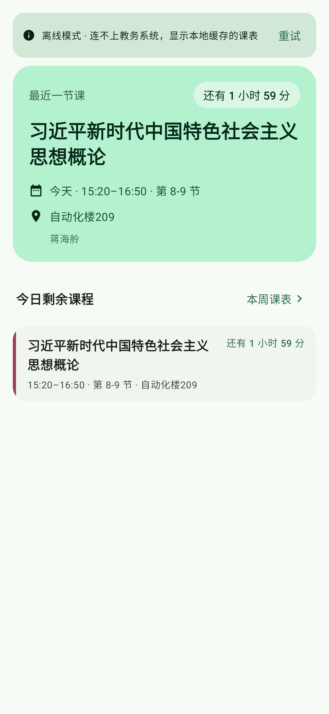

# 仲恺课表 · ZHKU Schedule

> 仲恺农业工程学院教务系统的第三方 Android 课表客户端：自动登录抓课表、首页倒计时、周视图、上课提醒，也可完全离线用一份 JSON 课表。

[](https://github.com/mackiont/ZHKUSchApp/actions/workflows/build-release.yml)
[](https://github.com/mackiont/ZHKUSchApp/actions/workflows/ci.yml)
[](https://github.com/mackiont/ZHKUSchApp/releases/latest)
[](LICENSE)

Kotlin + Jetpack Compose + Material 3，单 Activity 纯原生实现。最低支持 Android 8.0（API 26），编译目标 Android 16（API 36）。

| 首页（离线提示） | 本周课表 |
|---|---|
|  |  |

| 设置（在线） | 登录 / 本地导入 | 深色模式 |
|---|---|---|
|  |  |  |

> 截图由 Robolectric 在 JVM 上直接渲染 Compose 界面生成，与真机渲染一致，不需要模拟器。

## 功能

**首页**
- 「最近一节课」大卡片：课程名、地点、时间，以及距离开课还有几小时几分钟（每分钟刷新；上课中显示「还剩 N 分钟」）
- 今天剩余的课程列表，每行带倒计时；下拉刷新
- 顶部实时提示当前是**在线**、**离线兜底**还是**本地模式**

**课表**
- 7 天 × 12 节的周视图，按真实节次时间摆块，颜色按课程区分
- 左右箭头 / 标题下拉切换周次，「回到本周」一键归位
- 标题下拉底部有「本周其实是第几周？校正」，周次跑偏时随时纠回
- 点课程块看详情：教师、地点、周次、班级

**设置**
- 数据来源：在线 ↔ 本地模式切换、导入 / 导出课表 JSON
- 教学周：查看、手动校正、自动递增说明
- 每天固定时间自动获取课表（时间可改）
- 上课通知开关 + 提前分钟数
- 节次时间：白云 / 海珠校区预设 + 逐节微调
- 立即获取、退出登录

**后台**
- WorkManager 定时抓取，失败按指数退避重试，重启手机后任务仍在
- AlarmManager 精确闹钟提前提醒（Android 12+ 无权限时自动降级为非精确）

## 下载安装

从 [Releases](https://github.com/mackiont/ZHKUSchApp/releases/latest) 下载最新的 `zhku-schedule-<版本>.apk`，传到手机上安装即可（需允许「安装未知来源应用」）。

APK 使用 debug 证书自签名，与正式签名无关，仅用于个人侧载；因此**不要**用它覆盖任何从应用商店安装的版本。

```bash
adb install -r zhku-schedule-1.2.0.apk
```

## 首次使用

打开后二选一：

1. **在线模式**：填教务系统学号和密码登录，自动同步课表、支持定时刷新。
2. **本地模式（免登录）**：点登录页底部「导入课表 JSON（免登录）」，选一份课表 JSON，全程不联网。

登录后可以在设置 →「账号」里随时「导入课表 JSON」切成本地模式，本地模式下则是「重新导入」。

### 两种数据模式

| | 在线模式 | 本地模式 |
|---|---|---|
| 登录 | 学号 + 密码 | 不需要 |
| 课表来源 | 教务系统（每次获取后自动存一份快照） | 用户导入的 JSON |
| 定时获取 / 立即刷新 | 可用 | 不可用（应用完全不联网） |
| 上课提醒 | 可用 | 可用 |
| 断网时 | 自动使用最近快照，进入离线模式 | 本来就离线 |

### 本地课表 JSON 格式

与 `zhku_schedule.py -o schedule.json` 导出的格式完全一致，同时兼容本应用「导出课表 JSON」的产物：

```json
{
  "weekdays": { "1": 1, "2": 2 },
  "courses": [
    {
      "name": "高等数学II（1）",
      "teacher": "席亚讲师",
      "room": "经管楼209",
      "building": "经管楼",
      "weeks": "5,7-18(周)",
      "sections": [1, 2],
      "klass": "物联网[264-266]班",
      "weekday": 1
    }
  ],
  "params": { "zc": "18" }
}
```

解析很宽容，不必逐字段对齐：

- `weeks`：`"5,7-18(周)"` 字符串，或 `[5,7,8,...]` 整数数组
- `sections`：整数数组，或 `"1,2"` 字符串
- `weekday`：数字，或数字字符串
- `teacher` / `room` / `building` / `klass` 缺失不影响导入

导入时会弹窗确认**这份文件对应第几教学周**（默认取 `params.zc`）。这是 JSON 里唯一无法自证的信息：文件只有导出那一刻的周次，没有导出日期。应用以「导入时刻 + 该周次」为基准往后推算，所以：

- 文件是本周导出的 → 直接确认；
- 文件是几周前导出的 → 把周次改成它实际对应的那一周；
- 用久了周次跑偏 → 设置里「当前第 N 周」校正。

### 离线兜底

在线模式每次抓取成功都会把课表快照写进本地。重新打开应用会在后台静默更新一次：

- 成功 → 显示最新课表；
- 失败（服务器关闭 / 密码改了 / 断网）→ 继续显示上次快照，首页顶部提示「离线模式」，右上角可重试。

## 数据来源与登录协议

与 Python 版完全一致的接口（湖南强智科技 `jsxsd`）：

1. `GET /Logon.do?method=logon&flag=sess` 取 `scode#sxh`，按切片混淆算法生成 `encoded`
2. `POST /Logon.do?method=logon`（`userPassword` 传空）拿 `JSESSIONID`
3. `GET /jsxsd/xskb/xskb_list.do?Ves632DSdyV=NEW_XSD_PYGL` 拿服务端渲染的 HTML
4. 正则解析 `table#timetable`：`kbcontent` 全版 div + `<font title='教师|周次(节次)|教室|教学楼|班级'>`

> **会话必须全程保持。** 第 1 步下发的 `scode/sxh` 存在服务端会话里，`sess` 接口本身就会
> `set-cookie: JSESSIONID`。第 2 步若不带同一个会话，服务端找不到密钥，一律回
> 「该帐号不存在或密码错误」——账号密码正确也登不进去。所以客户端维护了一个 Cookie 罐，
> `JSESSIONID` 与负载均衡的 `SERVERID` 都要带上；登录成功后的 302 也要跟过去，才能拿到
> `/jsxsd` 用的会话。`ZhkuClientLoginTest` 用本地假服务器把这条约束锁成了测试。

「当前第几周」不靠学期开学日期算，而是读取课表页 `zc` 下拉框里服务端选中的那一项，连同抓取时间一起保存，之后按自然周推算——学期调整也不用改配置。

## 教学周怎么定

周次只有一个基准：**「某个时刻是第几周」**，其余日期按自然周算差值。

| 场景 | 周次来源 |
|---|---|
| 在线获取 | 读课表页 `zc` 下拉中教务系统选中的那一周，每次抓取都重新校准 |
| 在线但服务端没标周次（停在「全部」） | 用上次周次按自然周推算（设置里显示「按上次推算」） |
| 本地导入 | 导入确认框里指定的那一周 |
| 手动校正 | 设置 →「教学周」，或课表页标题下拉 →「本周其实是第几周？校正」 |

- **自动递增**：过了周日进入周一，周次 +1，不需要联网或开机任务；顶层每 60 秒重算，应用长期开着跨周也会自己跳。
- **不受总周数截断**：手动设成第 25 周，下周就是第 26 周，不会因为学期只有 20 周被夹回去。
- 在线模式下手动校正只影响本地推算，下一次成功获取会重新以教务系统为准。

## 节次时间

取自教务处《课堂教学时间及课间休息时间表》：

| 节次 | 白云校区 | 海珠校区 |
|---|---|---|
| 1 | 08:40–09:20 | 08:00–08:40 |
| 2 | 09:30–10:10 | 08:50–09:30 |
| 3 | 10:30–11:10 | 09:50–10:30 |
| 4 | 11:20–12:00 | 10:40–11:20 |
| 5 | （无，占位 12:10–12:50） | 11:30–12:10 |
| 6 | 13:30–14:10 | 14:30–15:10 |
| 7 | 14:20–15:00 | 15:20–16:00 |
| 8 | 15:20–16:00 | 16:20–17:00 |
| 9 | 16:10–16:50 | 17:10–17:50 |
| 10 | 19:00–19:40 | 19:30–20:10 |
| 11 | 19:50–20:30 | 20:20–21:00 |
| 12 | 20:40–21:20 | 21:10–21:50 |

作息如有调整，在设置里逐节改，改完立即生效。

## 技术栈

| | |
|---|---|
| 语言 / UI | Kotlin 2.1.20、Jetpack Compose（BOM 2025.05.00）、Material 3 |
| 最低 / 目标 | minSdk 26（Android 8.0）/ compileSdk & targetSdk 36（Android 16） |
| 构建 | AGP 8.9.2、Gradle 8.13、JDK 17（工具链）/ JDK 21 可运行 |
| 数据 | DataStore Preferences（设置、凭据、课表快照）、kotlinx.serialization |
| 后台 | WorkManager（定时抓取）、AlarmManager（上课提醒） |
| 网络 | 原生 `HttpURLConnection` + 自维护 Cookie 罐，无第三方网络库 |
| 测试 | JUnit 4、Robolectric 4.14（含 Compose 界面渲染截图）、Compose UI Test |

不混淆（关闭 R8）：项目大量依赖反射（kotlinx.serialization / DataStore），以保证「装上去就能跑」的确定性，体积差异只有几 MB。

## 目录结构

```
.
├── app/
│   ├── build.gradle.kts
│   └── src/
│       ├── main/java/cn/edu/zhku/schedule/
│       │   ├── MainActivity.kt          启动、权限、主题
│       │   ├── ZhkuApp.kt               通知渠道、定时任务兜底
│       │   ├── ScheduleViewModel.kt     状态与业务编排
│       │   ├── data/
│       │   │   ├── Models.kt            Course / Timetable / Settings / DataMode
│       │   │   ├── SectionTimes.kt      节次时间、校区预设、序列化
│       │   │   ├── ScheduleMath.kt      「今天上什么」「下一节课」「倒计时」
│       │   │   ├── TimetableParser.kt   强智课表 HTML 解析（正则 + 表格网格）
│       │   │   ├── LocalImport.kt       本地课表 JSON 解析 / 导出
│       │   │   ├── ZhkuClient.kt        登录混淆、Cookie、抓取、自动重登
│       │   │   ├── ScheduleRepository.kt抓取 / 导入 + 落盘
│       │   │   └── Prefs.kt             DataStore：设置、凭据、快照、数据模式
│       │   ├── notify/                  闹钟排程、通知、开机重排
│       │   ├── work/                    每日定时获取任务
│       │   └── ui/                      三个页面 + 登录页 + 导入确认框 + 主题
│       └── test/                        解析 / 导入 / 周次 / 登录 / 截图测试
├── screenshots/                         README 引用的界面截图
├── .github/workflows/                   自动构建、测试与发版
└── gradle/                              gradle wrapper（含腾讯云镜像配置）
```

## 本地构建

环境要求：

| 组件 | 版本 |
|---|---|
| JDK | 17 或更高（CI 用 Temurin 17） |
| Android SDK | Platform 36、Build-Tools 36 |
| Gradle | 用自带 wrapper（8.13），无需预装 |

```bash
# 首次：告诉 Gradle SDK 位置（CI 上由 ANDROID_HOME 提供，不需要此文件）
echo 'sdk.dir=/path/to/Android/sdk' > local.properties

./gradlew assembleRelease        # 产物 app/build/outputs/apk/release/app-release.apk
./gradlew assembleDebug          # 调试包
./gradlew testDebugUnitTest      # 解析/导入/存储单元测试 + 界面截图（无需账号与真机）
```

跑一次 `testDebugUnitTest` 就会把 Compose 界面渲染成 PNG，产物在 `app/build/screenshots/`（已复制到 `screenshots/`）。改完 UI 直接看效果，不用开模拟器。

`gradle/wrapper/gradle-wrapper.properties` 里把 `distributionUrl` 指向腾讯云镜像，国内网络下不会因为跳 GitHub 而卡住；在海外 CI 上也能正常下载。

## 自动构建与发布（GitHub Actions）

| 工作流 | 触发 | 干什么 |
|---|---|---|
| [`build-release.yml`](.github/workflows/build-release.yml) | push 到 `main`、打 `v*` 标签、手动 | 编译 `assembleRelease`，APK 作为 artifact 上传；**打标签时自动创建 Release 并附上 APK** |
| [`ci.yml`](.github/workflows/ci.yml) | push / PR | 跑 `testDebugUnitTest`，上传渲染出的界面截图作为 artifact |

### 发一个版本

```bash
# 1. 改 app/build.gradle.kts 里的 versionCode / versionName
#    versionCode 每次 +1，versionName 与标签保持一致
# 2. 提交后打标签并推送
git commit -am "chore: bump version to 1.2.1"
git tag v1.2.1
git push origin main --tags
```

推送标签后 Actions 会自动编译，并在 Releases 页面生成 `v1.2.1`，附 `zhku-schedule-1.2.1.apk`；Release 说明由 GitHub 自动汇总提交记录。也可以在 Actions 页面点「Run workflow」手动编译，只是不发布 Release。

签名说明：`release` 构建当前复用 debug 签名配置，所以 CI 无需注入密钥即可产出可直接安装的 APK。若要发布到应用商店，请自行生成 keystore，改为读取 `KEYSTORE_*` 系列 Secrets。

## 隐私

- 学号、密码、课表快照只写在应用私有目录（DataStore），不上传任何第三方服务器，也没有统计 / 埋点 SDK。
- 网络请求只发往学校教务系统 `edu-admin.zhku.edu.cn`。
- 应用声明 `android:allowBackup="false"`，避免凭据进入云备份。
- 本地模式完全不联网（仍声明了 INTERNET 权限，因为同一份 APK 需支持在线模式）。

## 已知限制

- 教务系统 `JSESSIONID` 是会话 Cookie，失效后需账号密码重新登录；应用保存了密码，因此能自动续期。不想存密码就只能每次手动登录。
- 强智单点登录会挤掉浏览器端会话，反之亦然。
- 「白云校区时间节次」在服务端返回空表（与 Python 版一致），所以只用「默认校区时间节次」。
- 本地课表没有「导出日期」字段，教学周只能靠导入时确认的周次推算；跨学期沿用同一个文件会不准，用「当前第 N 周」校正或重新导入。
- 只在 Android 8.0–16 的少量机型上验证过，未做平板 / 折叠屏专门适配。

## 免责声明

本项目是个人学习作品，与仲恺农业工程学院及教务系统厂商无关，非官方客户端。使用时请遵守学校相关规定，仅抓取自己的课表数据。因使用本应用造成的任何后果由使用者自行承担。

## 致谢

- 逆向自 [`zhku_schedule.py`](https://github.com/mackiont) 的课表抓取逻辑，接口与 JSON 格式保持兼容
- 代码主要由 [WorkBuddy](https://www.workbuddy.cn) 辅助开发

## License

[GNU General Public License v3.0](LICENSE)
