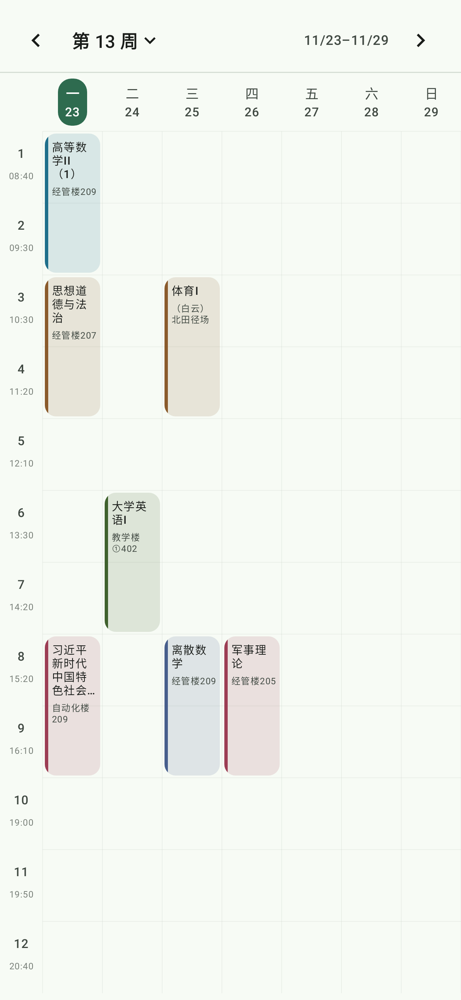
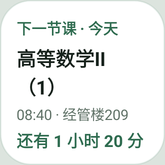

# 仲恺课表 · ZHKU Schedule

> 仲恺农业工程学院教务系统的第三方 Android 课表客户端：自动同步课表、首页倒计时、周视图、上课提醒、2×2 桌面小组件，也可以完全离线用一份 JSON 课表。

[](https://github.com/mackiont/ZHKUSchApp/actions/workflows/build-release.yml)
[](https://github.com/mackiont/ZHKUSchApp/actions/workflows/ci.yml)
[](https://github.com/mackiont/ZHKUSchApp/releases/latest)
[](LICENSE)

| 首页 | 本周课表 | 设置 |
|---|---|---|
|  |  |  |

| 登录 / 导入 | 桌面小组件 | 深色模式 |
|---|---|---|
|  |  |  |

## 功能

**首页** — 「最近一节课」大卡片：课程名、地点、时间、距开课还有多久，上课中显示「还剩 N 分钟」。下面是今天剩余的课程与倒计时，支持下拉刷新，顶部标明当前数据来源。

**课表** — 7 天 × 12 节的周视图，按真实节次时间摆块、按课程配色。左右箭头或标题下拉切周次，「回到本周」一键归位；点课程块看教师、地点、周次、班级。

**设置** — 在线 / 本地模式互切、导入导出课表、查看与校正教学周、每天定时自动获取、上课通知与提前分钟数、节次时间（白云 / 海珠预设 + 逐节微调）。

**提醒** — 按你的提前分钟数在上课前提醒；手机重启、改系统时间后自动重排。

**桌面小组件** — 2×2 正方形，显示最近一节课的课程名、上课时间与地点，附倒计时（精确到分钟）；正在上课时显示「还剩」，否则显示「还有」。

## 下载安装

从 [Releases](https://github.com/mackiont/ZHKUSchApp/releases/latest) 下载最新 APK，传到手机安装即可。

## 使用方法

打开后两条路：**在线模式**（登录教务系统，自动同步）或**离线模式**（导入一份课表 JSON，不联网）。

### 在线模式

1. 填教务系统学号和密码登录，自动抓取课表
2. 每次成功获取都会在本地存一份快照
3. 支持每天定时获取、立即刷新、上课提醒
4. 断网或服务器不可用时自动回落到最近的快照，首页顶部提示「离线模式」，右上角可重试

### 离线模式（免登录）

1. 登录页底部点「导入课表 JSON（免登录）」，选一份课表 JSON，全程不联网
2. 已登录用户可在设置 →「账号」→「导入课表 JSON」切过来，本地模式下按钮变成「重新导入」
3. 上课提醒照常可用，只是没有定时获取和刷新

课表文件可以直接用配套项目导出：

```bash
python zhku_schedule.py -o schedule.json
```

也兼容本应用「导出课表 JSON」的产物。导入时会弹窗确认**这份文件对应第几教学周** —— JSON 里只有周次、没有导出日期，这是唯一无法自证的信息。文件是本周导出的直接确认即可；几周前导出的就填它实际对应的那一周。

### 桌面小组件

两种添加方式，任选一种：

1. **长按应用图标**，在快捷菜单里点「添加小组件」——系统会直接问是否把小组件放到桌面（推荐，不用在列表里找）
2. 长按桌面空白处 → 添加小组件 / 添加工具 → 在列表里找「仲恺课表」（也可能显示为「最近一节课」）

> 小米 / HyperOS 的「添加工具」列表里如果没有本应用，用第一种方式可以绕过去。

- 固定 2×2 正方形，不可缩放
- 正在上课显示当前这节和「还剩」倒计时，否则显示下一节和「还有」倒计时
- 倒计时只到分钟（如「还有 1 小时 20 分」），不做逐秒跳动
- 字号按小组件实际尺寸整体缩放，不同桌面下比例一致
- 还没有课表时提示去应用里登录或导入
- 点击小组件直接打开应用

小组件每分钟自动刷新一次倒计时，上课、下课、跨天时会立即切换状态；App 不需要后台常驻。

> Android 14 起精确闹钟默认不授权。没有该权限时状态切换可能晚几分钟，倒计时最多慢一分钟。

### 校正教学周

周次跑偏时（比如本地课表用了半个学期），在两个地方都能改：

- 设置 →「教学周」→「当前第 N 周」
- 课表页标题下拉 →「校正」

改完从这一刻起按自然周递增，每周一自动 +1。

---

更多实现细节（登录协议、周次推算、小组件刷新机制、构建与发版、测试）见 **[TECHNICAL.md](TECHNICAL.md)**。

## License

[GNU General Public License v3.0](LICENSE) · 非官方客户端，与仲恺农业工程学院及教务系统厂商无关
