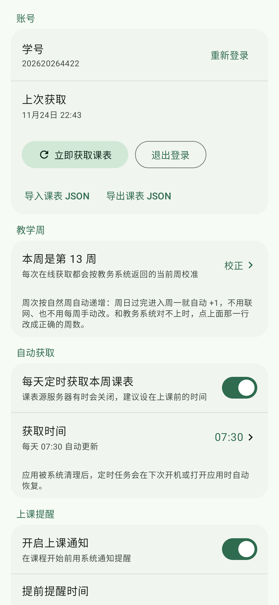
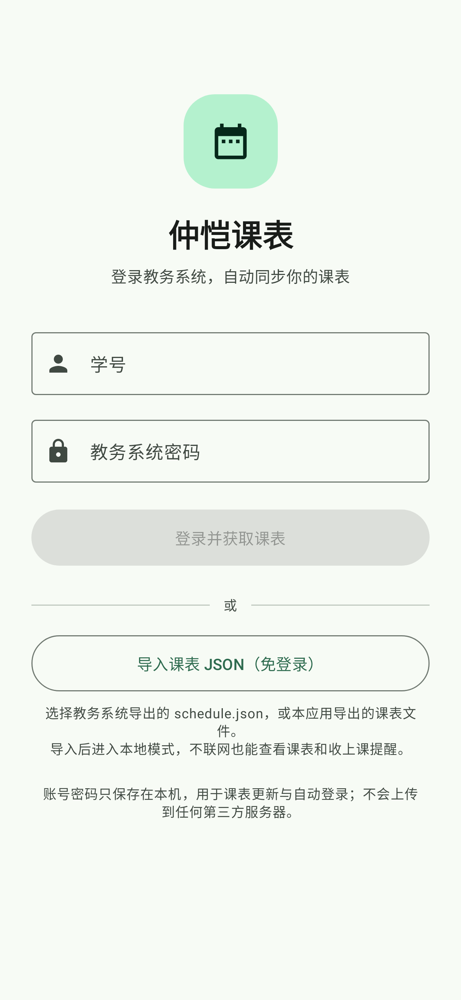
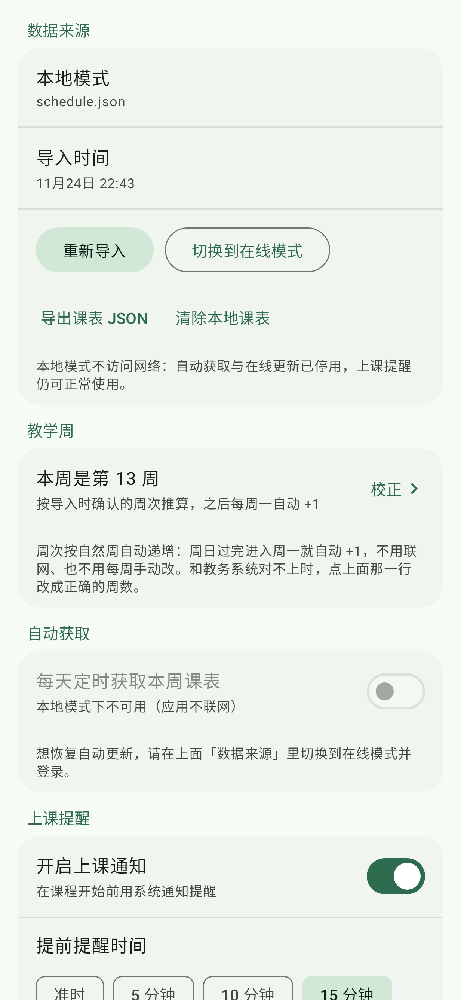
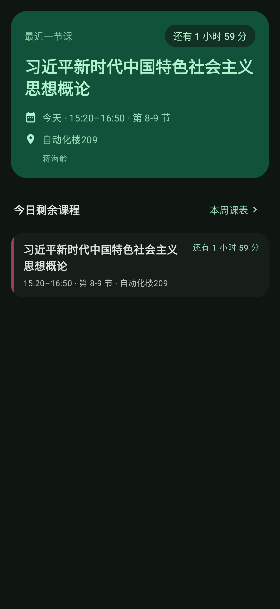
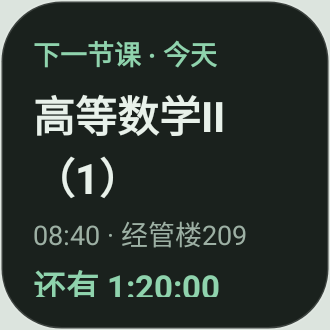

# 仲恺课表 · ZHKU Schedule

> 仲恺农业工程学院教务系统的第三方 Android 课表客户端：自动登录抓课表、首页倒计时、桌面小组件、周视图、上课提醒，也可完全离线用一份 JSON 课表。

[](https://github.com/mackiont/ZHKUSchApp/actions/workflows/build-release.yml)
[](https://github.com/mackiont/ZHKUSchApp/actions/workflows/ci.yml)
[](https://github.com/mackiont/ZHKUSchApp/releases/latest)
[](LICENSE)

Kotlin + Jetpack Compose + Material 3，单 Activity 纯原生实现。最低支持 Android 8.0（API 26），编译目标 Android 16（API 36）。

| 首页（离线提示） | 本周课表 | 设置（在线） |
|---|---|---|
|  |  |  |

| 登录 / 本地导入 | 设置（本地模式） | 深色模式 |
|---|---|---|
|  |  |  |

## 功能

**首页** — 「最近一节课」大卡片（课程名、地点、时间、距开课还有多久，上课中显示「还剩 N 分钟」），下面是今天剩余的课程与倒计时，下拉刷新，顶部提示当前数据来源。

**课表** — 7 天 × 12 节的周视图，按真实节次时间摆块、按课程配色；左右箭头或标题下拉切周次，「回到本周」一键归位；周次跑偏可在标题下拉里「校正」；点课程块看教师、地点、周次、班级。

**设置** — 在线 / 本地模式互切、导入导出课表 JSON、查看与校正教学周、每天定时自动获取、上课通知与提前分钟数、节次时间（白云 / 海珠预设 + 逐节微调）、立即获取、退出登录。

**后台** — WorkManager 定时抓取（失败指数退避，重启手机仍有效）；AlarmManager 精确闹钟提前提醒（Android 12+ 无权限时降级为非精确）。

**桌面小组件** — 2×2 正方形，显示最近一节课的课程名、开始时间、地点与逐秒倒计时，点一下打开应用。

## 桌面小组件

从桌面添加「仲恺课表 · 最近一节课」即可，2×2 正方形固定尺寸。正在上课时显示当前这节和「还剩」倒计时，否则显示下一节和「还有」倒计时；还没课表时提示去应用里登录或导入。

| 浅色 | 深色 |
|---|---|
|  |  |

「准时」靠两层配合，不做每分钟唤醒：

- **倒计时数字**交给 `Chronometer` 自己逐秒渲染，桌面进程负责刷新，App 睡着了数字也照走；
- **状态切换**（下一节 → 上课中 → 再下一节、以及跨天换「今天/明天」）只在关键那一秒用 `AlarmManager` 精确闹钟唤醒一次，改完再排下一次；
- 抓课表、导入、改节次、退出登录等任何写入都会立刻重绘，另有 30 分钟的系统兜底刷新。

> Android 14 起 `SCHEDULE_EXACT_ALARM` 默认不授予，没有该权限时闹钟退化为非精确：切换「上课中」可能晚几分钟，但倒计时数字始终准确。

## 下载安装

从 [Releases](https://github.com/mackiont/ZHKUSchApp/releases/latest) 下载最新 APK，传到手机上安装即可。

## 首次使用

打开后两条路：**在线模式**（登录教务系统，自动同步）或**离线模式**（导入一份课表 JSON，不联网）。

### 在线模式

- 填教务系统学号和密码登录，自动抓取课表，每次成功获取都会在本地存一份快照
- 支持每天定时获取、立即刷新、上课提醒
- 断网或服务器不可用时自动回落到最近的快照，首页顶部提示「离线模式」，右上角可重试

### 离线模式（免登录）

- 登录页底部点「导入课表 JSON（免登录）」，选一份课表 JSON 即可，全程不联网
- 已登录用户可在设置 →「账号」→「导入课表 JSON」切过来，本地模式下按钮是「重新导入」
- 上课提醒照常可用，只是没有定时获取和刷新

文件格式与 [`zhku_schedule.py -o schedule.json`](https://github.com/mackiont/ZHKUClassSchedule) 导出的完全一致，也兼容本应用「导出课表 JSON」的产物：

```json
{
  "weekdays": { "1": 1, "2": 2 },
  "courses": [
    {
      "name": "高等数学II（1）",
      "teacher": "席亚讲师",
      "room": "经管楼209",
      "building": "经管楼",
      "weeks": "5,7-18(周)",
      "sections": [1, 2],
      "klass": "物联网[264-266]班",
      "weekday": 1
    }
  ],
  "params": { "zc": "18" }
}
```

`weeks` 也可以是整数数组，`sections` 也可以是 `"1,2"` 字符串，`teacher` / `room` / `building` / `klass` 缺失都不影响导入。

导入时会弹窗确认**这份文件对应第几教学周**（默认取 `params.zc`）——JSON 里只有导出那一刻的周次、没有导出日期，这是唯一无法自证的信息。文件是本周导出的直接确认即可；几周前导出的就把周次改成它实际对应的那一周；用久了跑偏可在设置里「当前第 N 周」校正。

## 数据来源

课表通过教务系统（湖南强智科技 `jsxsd`）的网页接口获取，与 Python 版一致：请求 `sess` 拿 `scode/sxh` 生成 `encoded` → `POST /Logon.do` 登录 → 抓 `xskb_list.do` 页面 → 解析 `table#timetable`。

**登录全程必须复用同一个会话**（`JSESSIONID` / `SERVERID` 都要带上，302 也要跟过去），否则服务端找不到密钥，会误报「该帐号不存在或密码错误」。

接口细节、登录混淆算法、Cookie 约束与 JSON 格式见配套项目：**[ZHKUClassSchedule](https://github.com/mackiont/ZHKUClassSchedule)**。

## 教学周怎么定

周次只有一个基准：**「某个时刻是第几周」**，其余日期按自然周算差值。

| 场景 | 周次来源 |
|---|---|
| 在线获取 | 读课表页 `zc` 下拉中教务系统选中的那一周，每次抓取都重新校准 |
| 在线但服务端没标周次（停在「全部」） | 用上次周次按自然周推算 |
| 本地导入 | 导入确认框里指定的那一周 |
| 手动校正 | 设置 →「教学周」，或课表页标题下拉 →「校正」 |

过了周日进入周一自动 +1，不需要联网；不受学期总周数截断（设成第 25 周，下周就是第 26 周）。在线模式下手动校正只影响本地推算，下次成功获取会以教务系统为准。

## 节次时间

取自教务处《课堂教学时间及课间休息时间表》：

| 节次 | 白云校区 | 海珠校区 |
|---|---|---|
| 1 | 08:40–09:20 | 08:00–08:40 |
| 2 | 09:30–10:10 | 08:50–09:30 |
| 3 | 10:30–11:10 | 09:50–10:30 |
| 4 | 11:20–12:00 | 10:40–11:20 |
| 5 | （无，占位 12:10–12:50） | 11:30–12:10 |
| 6 | 13:30–14:10 | 14:30–15:10 |
| 7 | 14:20–15:00 | 15:20–16:00 |
| 8 | 15:20–16:00 | 16:20–17:00 |
| 9 | 16:10–16:50 | 17:10–17:50 |
| 10 | 19:00–19:40 | 19:30–20:10 |
| 11 | 19:50–20:30 | 20:20–21:00 |
| 12 | 20:40–21:20 | 21:10–21:50 |

作息如有调整，在设置里逐节改，改完立即生效。

## 构建

Releases 里的 APK 全部由 GitHub Actions 自动构建：推送 `v*` 标签触发 [`.github/workflows/build-release.yml`](.github/workflows/build-release.yml)，编译 `assembleRelease` 并发布 Release。

## 隐私

- 学号、密码、课表快照只写在应用私有目录（DataStore），不上传任何第三方服务器，也没有统计 / 埋点 SDK
- 网络请求只发往学校教务系统 `edu-admin.zhku.edu.cn`
- `android:allowBackup="false"`，避免凭据进入云备份
- 离线模式完全不联网

## 已知限制

- 教务系统的 `JSESSIONID` 是会话 Cookie，失效后需要账号密码重新登录；应用保存了密码，因此能自动续期
- 强智单点登录会挤掉浏览器端会话，反之亦然
- 「白云校区时间节次」在服务端返回空表（与 Python 版一致），所以只用「默认校区时间节次」
- 本地课表没有导出日期，跨学期沿用同一个文件会不准，用「当前第 N 周」校正或重新导入

## 免责声明

本项目是个人学习作品，与仲恺农业工程学院及教务系统厂商无关，非官方客户端。使用时请遵守学校相关规定，仅抓取自己的课表数据。因使用本应用造成的任何后果由使用者自行承担。

## 致谢

- 课表抓取逻辑逆向自 [ZHKUClassSchedule](https://github.com/mackiont/ZHKUClassSchedule)，接口与 JSON 格式保持兼容
- 代码主要由 [WorkBuddy](https://www.workbuddy.cn) 辅助开发

## License

[GNU General Public License v3.0](LICENSE)
